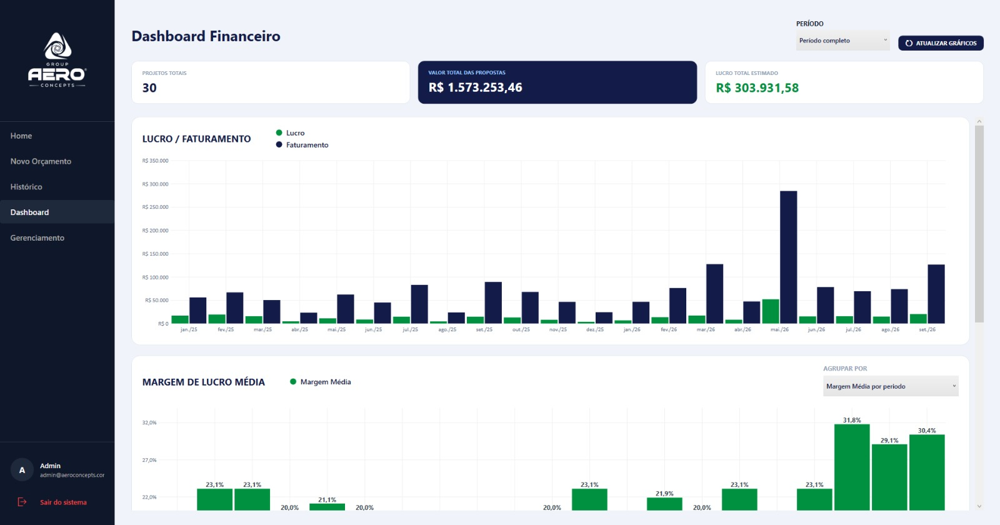
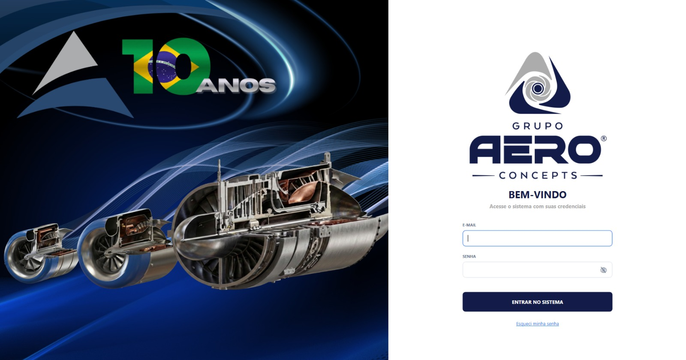
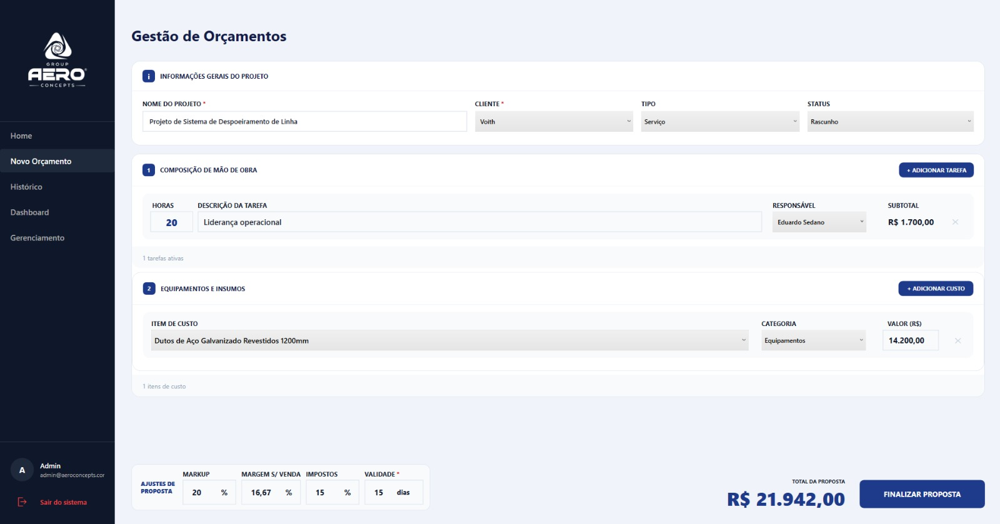
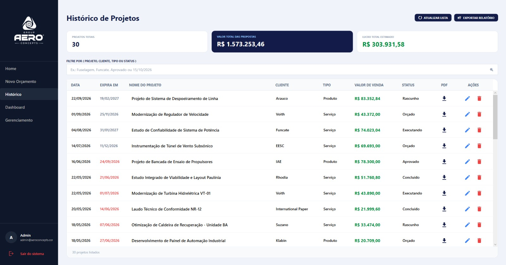
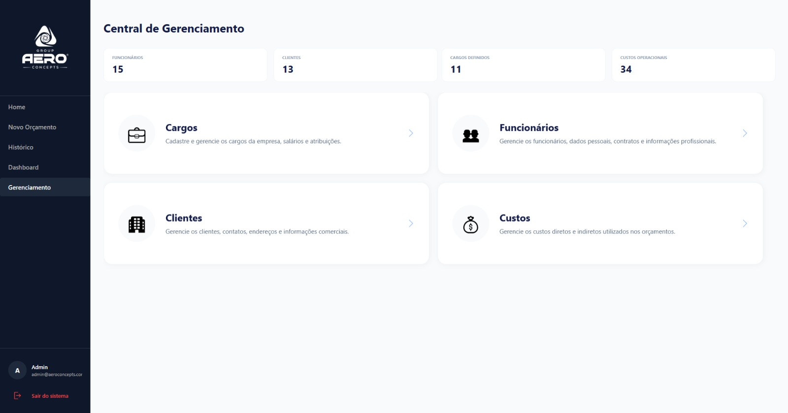
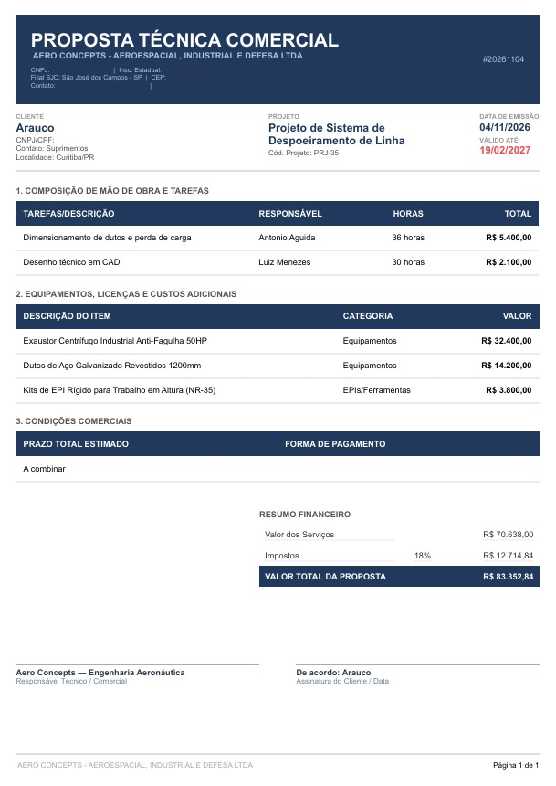

<div align="center">

# AERO Concepts
### Sistema de Precificação e Gestão de Projetos

Orçamentos precisos, projetos organizados e indicadores financeiros em um só lugar.


[Funcionalidades](#funcionalidades) ·
[Telas](#telas) ·
[Tecnologias](#tecnologias) ·
[Como executar](#como-executar) ·
[Equipe](#equipe)



</div>

---

## Sobre o projeto

O **AERO Concepts** é um sistema desktop para apoiar a elaboração de orçamentos, a gestão de projetos e a análise financeira da empresa. Foi desenvolvido como Trabalho de Conclusão de Curso (TCC) do Curso Técnico em Informática.

Ele centraliza o gerenciamento de **projetos, clientes, funcionários e custos**. Com isso, o orçamento é montado com mais precisão e os indicadores financeiros são acompanhados por dashboards e relatórios em PDF.

## Índice

- [Funcionalidades](#funcionalidades)
- [Telas](#telas)
- [Tecnologias](#tecnologias)
- [Arquitetura](#arquitetura)
- [Integridade e segurança dos dados](#integridade-e-segurança-dos-dados)
- [Como executar](#como-executar)
- [Status do projeto](#status-do-projeto)
- [Equipe](#equipe)

## Funcionalidades

| Módulo | Recursos |
|---|---|
| **Login** | Autenticação, controle de sessão, cadastro de usuários |
| **Orçamentos** | Criação de projetos, seleção de clientes e funcionários, composição de mão de obra, associação de custos, markup, margem, impostos e geração da proposta |
| **Histórico** | Consulta, filtros de pesquisa, edição de projetos existentes e download da proposta em PDF |
| **Clientes** | Cadastro, edição, exclusão, pesquisa e exportação em PDF |
| **Funcionários** | Cadastro, edição, exclusão, pesquisa e exportação em PDF |
| **Cargos** | Cadastro, edição e exclusão |
| **Custos** | Catálogo, categorias, valores de referência, pesquisa e exportação em PDF |
| **Dashboard** | Indicadores (projetos, faturamento, lucro estimado), gráficos de lucro x faturamento e margem média, filtros por período |
| **Relatórios** | Exportação em PDF de clientes, funcionários, custos e projetos |

## Telas

### Login


### Gestão de Orçamentos


### Histórico de Projetos


### Dashboard Financeiro


### Central de Gerenciamento


### Proposta Técnica Comercial (PDF)
<div align="center">
  
</div>

## Tecnologias

| Camada | Tecnologia |
|---|---|
| Interface | WPF (.NET) + XAML, padrão MVVM |
| Linguagem / Runtime | C# / .NET 10 |
| Banco de dados | MySQL (`MySql.Data`) |
| Gráficos | LiveCharts.Wpf |
| Relatórios e propostas | QuestPDF |

## Arquitetura

```text
magal/
├── Models          # Entidades do domínio
├── Views           # XAML + code-behind
├── ViewModels      # Lógica de apresentação (MVVM)
├── Data
│   └── Repositories  # Acesso ao banco e regras de integridade
├── Services        # Hash de senha, throttle de login, geração de PDF, tratamento de erros
└── Scripts         # init.sql (schema + carga inicial) e scripts de verificação
```

## Integridade e segurança dos dados

- **Senhas** com hash e **limite de tentativas de login** (throttle).
- **Exclusão com vínculos:** não é possível excluir cargo, cliente, funcionário, usuário ou item de catálogo que esteja em uso. A mensagem informa a quantidade e os nomes dos registros vinculados.
- **Duplicidade:** cargos por nome, clientes por CPF/CNPJ e itens de catálogo por nome e categoria são validados ao inserir e atualizar.
- **Último administrador:** o sistema impede excluir, rebaixar ou inativar o único administrador ativo.
- **Erros amigáveis:** o usuário vê mensagens claras em português. O detalhe técnico vai para um log local, com credenciais mascaradas.
- **SQL parametrizado** em todas as verificações.

## Como executar

### Pré-requisitos

- Windows com [.NET 10 SDK](https://dotnet.microsoft.com/download)
- MySQL Server acessível (local ou remoto)

### 1. Banco de dados

Execute `magal/Scripts/init.sql` em uma instância MySQL para criar o schema `sad_precificacao` e a carga inicial.

### 2. Connection string

O `magal/appsettings.json` é versionado com a connection string vazia. Crie o arquivo `magal/appsettings.local.json` (ignorado pelo git) com suas credenciais; ele sobrescreve o `appsettings.json` em tempo de execução:

```json
{
  "ConnectionStrings": {
    "DefaultConnection": "Server=SEU_HOST;Port=3306;Database=sad_precificacao;Uid=SEU_USUARIO;Pwd=SUA_SENHA;SslMode=Disabled;AllowPublicKeyRetrieval=True;"
  }
}
```

> [!WARNING]
> Nunca faça commit de credenciais reais. Use sempre o `appsettings.local.json`.

### 3. Build e execução

```bash
dotnet build magal/magal.csproj
dotnet run --project magal/magal.csproj
```

## Status do projeto

Em desenvolvimento.

**Já implementado**

- [x] Autenticação com hash de senha e throttle de login
- [x] Gestão de clientes, funcionários, cargos e custos
- [x] Orçamentos e histórico de projetos
- [x] Dashboard financeiro e relatórios em PDF
- [x] Verificações de vínculos, duplicidade e tratamento de erros

**Próximas melhorias**

- [ ] Recomendação inteligente de recursos
- [ ] Indicadores avançados e dashboard executivo
- [ ] Relatórios analíticos avançados

## Equipe

Projeto desenvolvido como Trabalho de Conclusão de Curso (TCC).

| Nome |
|---|
| João Guilherme Pereira Mendes |
| Vinícius Brisolla de Vasconcelos |
| Miguel Quintanilha Gomes de Sales |

---

<div align="center">

**AERO Concepts**, aeroespacial, industrial e defesa.

</div>
